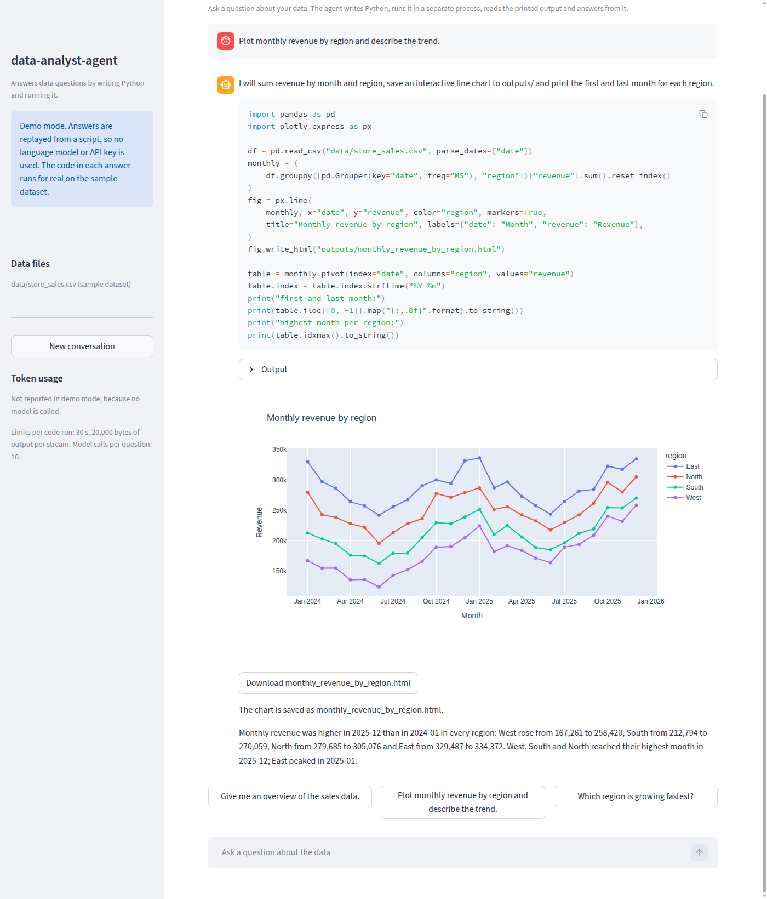
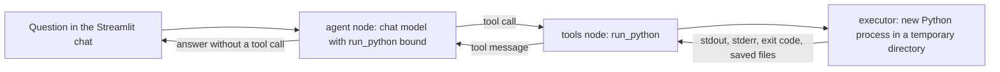
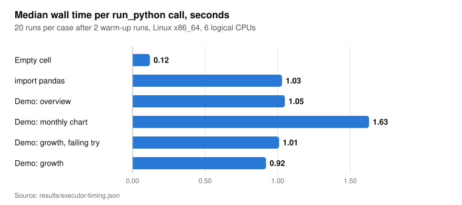

# data-analyst-agent

A LangGraph agent that answers questions about CSV and Excel files by writing Python, running it in a separate process with a timeout, and answering from the printed output. It has a Streamlit chat page and a scripted demo mode that needs no API key.

<picture>
  <source media="(prefers-color-scheme: dark)" srcset="docs/figures/demo-chart-dark.png">
  
</picture>

Screenshot of `DEMO_MODE=1 ./run.sh` after the second demo question, taken on 2026-10-30. The code output and the chart come from the executor running on [store_sales.csv](src/data_analyst_agent/sample_data/store_sales.csv); the code and the text are replayed from [demo_script.py](src/data_analyst_agent/demo_script.py).

## What it does

- Runs a ReAct loop on LangGraph: the model writes code for one tool, `run_python`, reads the result and either calls the tool again or answers.
- Runs each tool call in a new Python process with a wall-clock timeout, a temporary working directory, an environment built from an allowlist (no API keys) and a cap on captured output.
- Shows saved charts and files in the chat. Plotly HTML renders inline, images render as images, and every file has a download button.
- Supports OpenAI and Anthropic models, chosen in the sidebar. Model IDs come from environment variables.
- Reports token usage per question and per session, summed over every model call in the question.
- Offers a demo mode (`DEMO_MODE=1`) that replays three prepared questions without a model. The code in each answer runs for real on a bundled dataset that a seeded script generates.

## How it works



**Loop.** [graph.py](src/data_analyst_agent/graph.py) builds a two-node `StateGraph` over `MessagesState`. The agent node calls the model with the system prompt from [prompts.py](src/data_analyst_agent/prompts.py); a conditional edge routes to the `ToolNode` while the model returns tool calls. `MAX_AGENT_ITERATIONS` caps the model calls per question; [turn.py](src/data_analyst_agent/turn.py) converts the LangGraph recursion error into a message in the chat. A failed question is shown but is not added to the history the model sees on the next question.

**Executor.** [executor.py](src/data_analyst_agent/executor.py) writes the code to `cell.py` in a new temporary directory, copies the session's data files into `data/`, and starts `python -I` with `stdin` closed, a new session and an environment of seven variables (`PATH`, `HOME`, `TMPDIR`, `LANG`, `LC_ALL`, `MPLBACKEND`, `MPLCONFIGDIR`). Two reader threads keep at most `MAX_OUTPUT_BYTES` of stdout and of stderr. At `CODE_TIMEOUT_S`, and again after every normal exit, the whole process group gets `SIGKILL`, so background processes started by the code do not outlive the call while they stay in that group. A process that the code moves to a new session or process group (`setsid`, `subprocess.Popen(..., start_new_session=True)`) is not killed. Files written to `outputs/` are moved to the session's artifact folder and listed in the tool message artifact, which is how the page finds charts. At most 20 files of at most 25 MB each are kept per call; the tool message names the files that were not saved. The directory is then deleted.

**Streaming.** `run_turn` reads the graph with the `messages`, `updates` and `values` stream modes and yields typed events: text deltas, code submitted, code finished and turn finished. The page redraws only the part of the reply that changed.

**Demo mode.** [replay.py](src/data_analyst_agent/replay.py) is a LangChain chat model that looks up the last question in a script and returns the next scripted step, streamed word by word. It makes no network calls. Its tool calls go through the same graph, tool and executor as a real model's. The third demo question includes a deliberate wrong column name, so the recording shows a `KeyError` and the corrected rerun. `tests/test_graph.py` fails if a number in a scripted answer does not appear in the code output.

## Results

The executor starts a new interpreter for every tool call, so every call pays the interpreter start and the imports again. [scripts/bench_executor.py](scripts/bench_executor.py) measured this and wrote [results/executor-timing.json](results/executor-timing.json): 20 runs per case after 2 warm-up runs, on one Linux x86_64 machine with 6 logical CPUs and Python 3.11.13, at revision 4a93e33 on 2026-10-30. The median call with an empty cell takes 0.12 s. Importing pandas raises it to 1.03 s, so the four demo code runs, which all import pandas, take 0.92 s to 1.63 s. The chart run is the slowest because it also imports Plotly and writes an HTML file with Plotly's JavaScript inline. Reproduce with `uv run python scripts/bench_executor.py`; timings depend on the machine.

<picture>
  <source media="(prefers-color-scheme: dark)" srcset="docs/figures/executor-timing-dark.svg">
  
</picture>

<details><summary>Data table</summary>

| Case | Median, s |
|---|---|
| Empty cell | 0.12 |
| import pandas | 1.03 |
| Demo: overview | 1.05 |
| Demo: monthly chart | 1.63 |
| Demo: growth, failing try | 1.01 |
| Demo: growth | 0.92 |

Source: `results/executor-timing.json`, field `total_s.median`, rounded to 0.01 s.

</details>

## Quickstart

Requires [uv](https://docs.astral.sh/uv/) and Linux or macOS. The executor uses POSIX process groups and does not run on Windows outside WSL.

```bash
git clone https://github.com/darblinko/data-analyst-agent
cd data-analyst-agent
uv sync
uv run pytest -q
DEMO_MODE=1 ./run.sh
```

Open http://localhost:8501 and pick one of the three demo questions. No API key is used.

To ask your own questions, copy `.env.example` to `.env`, set `OPENAI_API_KEY` or `ANTHROPIC_API_KEY`, and run `./run.sh`. Upload files in the sidebar, or press "Add sample dataset".

| Variable | Default | Meaning |
|---|---|---|
| `DEMO_MODE` | `0` | `1` replays the scripted demo |
| `LLM_PROVIDER` | `openai` | Provider selected at start: `openai` or `anthropic` |
| `OPENAI_MODEL` | `gpt-4o` | OpenAI model ID |
| `ANTHROPIC_MODEL` | `claude-sonnet-5-5` | Anthropic model ID offered first |
| `ANTHROPIC_SMALL_MODEL` | `claude-haiku-5-5` | Second Anthropic model ID in the sidebar |
| `CODE_TIMEOUT_S` | `30` | Wall-clock limit per code run, seconds |
| `MAX_OUTPUT_BYTES` | `20000` | Bytes kept per stream per code run |
| `MAX_AGENT_ITERATIONS` | `10` | Model calls per question |

Variables set in the shell take precedence over `.env`. The sample dataset is regenerated with `uv run python scripts/make_sample_data.py`; the output is identical on every run.

## Project layout

```
app.py                         Streamlit entry point
run.sh                         Starts Streamlit on localhost:8501
src/data_analyst_agent/
  executor.py                  Subprocess executor: timeout, temporary directory, environment allowlist, output cap
  python_tool.py               The run_python tool
  graph.py                     LangGraph ReAct loop
  turn.py                      Runs one question and yields UI events
  prompts.py                   System prompt
  models.py                    OpenAI, Anthropic and demo chat models
  replay.py                    Scripted chat model for demo mode and tests
  demo_script.py               The three demo questions
  settings.py                  Environment variables
  usage.py                     Token usage sums
  workspace.py                 Per-session data and artifact folders
  transcript.py                Chat entries built from turn events
  sample_data/store_sales.csv  Generated sample dataset
  ui/                          Streamlit page, sidebar and rendering
scripts/
  make_sample_data.py          Generates the sample dataset from a fixed seed
  bench_executor.py            Writes results/executor-timing.json and docs/data.json
tests/                         Offline tests: executor, replay, graph, models, settings, UI
docs/                          Landing page and README figures
```

## Design decisions and limitations

- **Process isolation, not a sandbox.** The child process runs as the same user as the app. It can read and write every file that user can, open network connections and use all available memory and CPU until the timeout. The environment allowlist keeps API keys out of the child's environment, but a `.env` file on disk is readable by the generated code. Processes that leave the process group survive the call. Do not run untrusted prompts or untrusted data files with this setup; run the app in a container or VM with no secrets mounted, a read-only file system outside the work directory and resource limits.
- **Saved HTML is shown as written.** Charts in `outputs/*.html` are produced by generated code and rendered with `streamlit.components.v1.html`. That iframe has both `allow-scripts` and `allow-same-origin` in its sandbox attribute (the browser console warns about it), so a script in the HTML can reach the page. Treat saved HTML with the same trust as the code.
- **No state between code runs.** Each call is a new process, so variables and imports do not carry over and the model reloads the data in every call. The system prompt says so. This costs the start time measured above and removes one class of cross-session leaks that a shared `exec()` namespace had.
- **POSIX only.** The timeout kills the process group with `os.killpg`, which Windows does not provide.
- **Model defaults.** The Anthropic defaults are `claude-sonnet-5-5` and `claude-haiku-5-5`. The Anthropic client sends no `temperature`, because current Claude models reject non-default sampling parameters. The OpenAI default `gpt-4o` is the model the project was used with before publication; check that it is still offered to your account, or set `OPENAI_MODEL`.
- **Not tested against live APIs.** The test suite uses the replay model only, so it covers the loop, the tool and the page, but not provider behavior such as refusals, rate limits or a model that ignores the instruction to quote printed numbers. Provider errors end the question with an error message in the chat.
- **Demo mode answers three questions only.** Other questions get a message listing the three. Token usage is not reported in demo mode because no model is called.
- **Session files are not cleaned up.** Uploaded files and saved charts stay in a `data-analyst-agent-session-*` folder under the system temporary directory until the operating system removes it.

## License

Apache-2.0. See [LICENSE](LICENSE).
